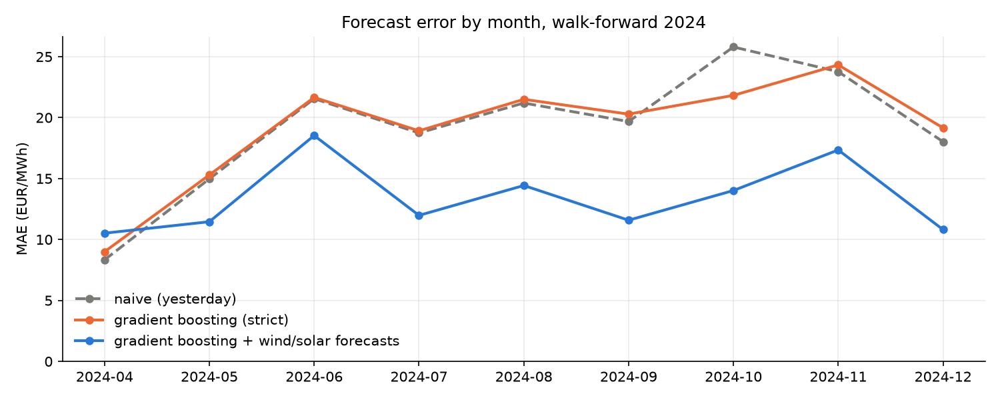

# European day-ahead electricity prices: electricity, gas and carbon

Personal project. What drives day-ahead electricity prices in Europe, starting with Spain (2024), and how gas (TTF) and EU ETS carbon (EUA) prices feed into them. Can a simple model forecast tomorrow's prices better than "same as yesterday"?

**Status:** Spain exploration and residual load (notebook 01), gas / carbon / clean spark spread (notebook 02) and price forecasting with walk-forward validation (notebook 03) are done. Other countries are planned, not done.

## The project in one minute

| Question                                          | Short answer (Spain, 2024)                                                                                                                                                                                                   | Notebook |
| ------------------------------------------------- | ---------------------------------------------------------------------------------------------------------------------------------------------------------------------------------------------------------------------------- | -------- |
| What makes the price go up or down within a day?  | Mostly how much demand is left once wind and solar have produced: about +5 EUR/MWh per extra GW. At midday with a lot of solar, the price often falls to 0 or below.                                                         | 01       |
| Do prices follow the cost of running a gas plant? | On average, no: the price is below the cost of a gas plant most of the time. In the evening, once solar is gone, it comes much closer.                                                                                       | 02       |
| Does carbon matter?                               | Yes for the level of the cost (about 28 %), little for its day-to-day variation: gas moves the price more than carbon does.                                                                                                  | 02       |
| Can we forecast tomorrow's prices?                | Using only what is known before the auction, barely better than "same as yesterday". Adding the grid operator's wind and solar forecasts helps a lot, but those may be published too late, so that result is an upper bound. | 03       |

## Background: how to read the numbers

- **Day-ahead auction.** Every day at 12:00 (Central European time), one auction sets the 24 hourly electricity prices of the next day (since October 2025 it uses 15-minute periods; the 2024 data used here are hourly). A forecast of tomorrow's prices must therefore be made with what is known at noon today.
- **Merit order.** Power plants are called from the cheapest to the most expensive until demand is met. The last plant needed sets the price. Wind and solar have almost no running cost, so a lot of wind and solar pushes expensive plants out and lowers the price.
- **Residual load** = demand - wind - solar. It is the demand that the other plants (gas, hydro, nuclear, imports...) must cover. High residual load means expensive plants are needed, so a high price.
- **Marginal cost of a gas plant** = (gas price + 0.202 x carbon price) / efficiency, in EUR per MWh of electricity. Burning 1 MWh of gas emits 0.202 tonnes of CO2, and the plant must buy that many EU carbon allowances. An efficiency of 0.50 means 2 MWh of gas for 1 MWh of electricity.
- **Clean spark spread** = electricity price - marginal cost. Positive: a gas plant makes money at that price. Negative: it loses money, so it would rather stay off.

## Key findings (Spain, 2024)

### 1. When solar is strong, prices fall to zero or below

784 hours (8.9 %) had a price of 0 or below. 65 % of them were in spring and 80 % between 10:00 and 17:59, the hours of high solar output.
*How to read it:* when supply from solar and wind is more than enough, the price at the margin is close to zero or slightly negative. The cause of each individual hour (inflexible plants, export limits, curtailment) was not tested.

### 2. Residual load explains about half of the price variation

A straight-line fit gives about +5 EUR/MWh per additional GW of residual load, R2 = 0.53, correlation 0.73.
*How to read it:* R2 = 0.53 means the line explains about half of the hourly variance; the rest is spread around it. By level of residual load, the mean price goes from about 10 EUR/MWh below 5 GW to about 111 EUR/MWh above 20 GW. This is an association on realised values, not a causal estimate.

### 3. The price is below the cost of a gas plant most of the time

Mean day-ahead price 63 EUR/MWh against a gas-plant marginal cost of about 96 EUR/MWh (efficiency 0.50). Mean clean spark spread -33 EUR/MWh; only 18 % of days are positive (6 % to 35 % for efficiencies 0.45 to 0.60).
*How to read it:* gas plants are not setting the price most of the time; other sources (solar, wind, hydro, nuclear, imports) do. The result depends on the assumed efficiency, hence the sensitivity range.

- **Evening vs midday.** In summer, the mean price is about 107 EUR/MWh at 20-22 h against 40 at 12-15 h. The spread is about -57 EUR/MWh at 12-15 h (5 % of hours positive) and about -5 at 20-22 h (53 % positive). Consistent with gas being near the margin once solar is gone; it is not a test of who sets the price.
- **Gas matters more than carbon in the daily variation.** The daily correlation of the price with the marginal cost is 0.66, with TTF alone 0.67, with the EUA alone 0.25. Carbon is a nearly constant share of the cost (about 28 %, 27 EUR/MWh). A move of 10 EUR/t in the EUA changes the marginal cost by about 4 EUR/MWh (0.202 x 10 / 0.5).
- **Seasons.** The spread is closest to zero in November-December and most negative from March to May (no positive day). The solar share alone does not explain the spring gap (daily R2 of the spread on the solar share: 0.05); hydro, wind and lower demand are untested candidates.
- **Robustness.** Aligning gas and carbon prices on the same day, D-1 or D-2 gives the same result (correlation 0.65-0.66, mean spread about -33 EUR/MWh).


### 4. Forecasting: yesterday's price is hard to beat without a wind and solar forecast

**The set-up.** Each day at 12:00 (auction closing), forecast the 24 prices of the next day using only information available at that time: past prices, the grid operator's load forecast, gas and carbon closes up to two days earlier, and the calendar. Test: April-December 2024, 269 days, 6,457 hourly forecasts, walk-forward (train on the past, forecast the next month, then slide forward), never a random split. `tests/test_no_leakage.py` checks that no information from the future gets in.

**The results.**

| Model                                                   | MAE  | RMSE | MAE vs naive | DM p-value vs naive |
| ------------------------------------------------------- | ---- | ---- | ------------ | ------------------- |
| Naive, same hour yesterday                              | 19.1 | 28.4 | -            | -                   |
| Naive, weekday rule (Tue-Fri yesterday, else last week) | 21.9 | 32.7 | +15 %        | 0.04 (worse)        |
| Ridge, features known at noon D-1                       | 18.2 | 23.8 | -5 %         | 0.17                |
| Gradient boosting, same features                        | 18.1 | 23.8 | -5 %         | 0.15                |
| Ridge + wind / solar forecasts                          | 15.4 | 19.8 | -19 %        | < 0.001             |
| Gradient boosting + wind / solar forecasts              | 14.2 | 18.5 | -26 %        | < 0.001             |

**How to read the table.**

- **MAE** is the average size of the error in EUR/MWh (average price over the period: about 69). **RMSE** penalises large errors more.
- **Naive** means "same hour yesterday". A model is only useful if it beats it.
- **DM p-value** (Diebold-Mariano test on daily errors): a small value means the difference with the naive forecast is unlikely to be luck. Without wind and solar forecasts, the gain (19.1 to 18.1) is **not statistically significant** (p = 0.15), although RMSE improves more clearly (28.4 to 23.8). With them, the gain is clear (p < 0.001). The p-values are not corrected for the number of comparisons.
- **Why the caveat.** The wind and solar forecasts of the grid operator may be published until 18:00 on D-1, after the auction closes at 12:00. If they were not available at noon, the last two rows are an **optimistic bound**, not a result a trader could have used.
- **By time of day.** The strict models beat the naive forecast at midday (MAE 16.8 vs 19.8 for the 12-15 h block, where solar makes the price depend on the weather) and do worse in the evening (19.0 vs 16.3 for 20-23 h).
- **What the model relies on.** Permutation importance (shuffle one input and see how much the error grows) puts the residual-load forecast far ahead of the other inputs (about +11.8 EUR/MWh on the October-December test). This reflects what the model uses, not a causal effect: gas barely appears because yesterday's price already contains its information.



## Questions

1. How do solar, wind and demand shape the daily price profile, by season? *(notebook 01, done)*
2. How does the price relate to residual load, and what does it say about the merit order? *(notebook 01, done)*
3. Do prices follow the marginal cost of gas plants (TTF, EUA)? Clean spark spread. *(notebook 02, done)*
4. How do Spain, France, Germany and the Netherlands differ? *(planned)*
5. Simple forecast vs naive baseline, using only information known before the auction. *(notebook 03, done)*

## Plan

- [x] Block A: Spain, exploration and residual load (`notebooks/01_exploration.ipynb`)
- [ ] Block B: add FR, DE, NL and compare
- [x] Block C: gas (TTF) and carbon (EUA) series, marginal cost, clean spark spread (`notebooks/02_gas_carbon_spread.ipynb`)
- [x] Block D: synthesis (this README)
- [x] Block E: forecasting (baseline vs ML, walk-forward validation, no look-ahead; `notebooks/03_forecasting.ipynb`, `src/forecast.py`, `tests/`)

## Data

| Series                                                               | Source                                                    | Frequency             | Notes                                                                                             |
| -------------------------------------------------------------------- | --------------------------------------------------------- | --------------------- | ------------------------------------------------------------------------------------------------- |
| Spain day-ahead price, generation by type, load, day-ahead forecasts | ENTSO-E Transparency Platform (via `entsoe-py`)           | hourly after cleaning | Downloaded with `src/download_entsoe.py`; token in `.env`                                         |
| Gas                                                                  | Yahoo Finance, ticker `TTF=F`                             | daily close           | Front-month TTF future, continuous series                                                         |
| TSO day-ahead forecasts (load, wind, solar)                          | ENTSO-E Transparency Platform                             | hourly                | Used by the forecasting models; see limits for their publication time                             |
| Carbon                                                               | Investing.com, "Carbon Emissions Futures Historical Data" | daily close           | Nearest-December EUA future (the most liquid contract), continuous series, CSV downloaded by hand |

Raw and processed data are not committed. To rebuild: run the download script, then save the carbon CSV as `data/raw/Carbon Emissions Futures Historical Data.csv` (daily, 2023-12-01 to 2025-01-03). The TTF series is downloaded once and cached in `data/raw/ttf_daily.csv`. Data from third-party sites is for personal, non-commercial use.

## Method

- **Time handling.** Source CSVs mix UTC offsets, so timestamps are parsed in UTC and converted to `Europe/Madrid`. Quarter-hourly or sub-hourly values are averaged to hourly means (MW are averaged, never summed). Short gaps (up to 3 hours) are interpolated; forecast series are not interpolated. Audit of gaps and daylight-saving days is in notebook 01. Days are grouped by Madrid local date, which is the market day.
- **Residual load** = load - wind - solar, realised values.
- **Marginal cost of a gas plant** (EUR/MWh of electricity) = (gas price + EF x carbon price) / efficiency.
  - EF = 0.202 tCO2 per MWh of gas: IPCC 2006 Guidelines, vol. 2, ch. 2, table 2.2 (56.1 tCO2/TJ, net calorific basis).
  - Efficiency = 0.50: an assumption. No single official figure for the Spanish fleet was found; the EEA indicates that combined-cycle plants can reach about 60 %. A sensitivity analysis (0.45 to 0.60) is in notebook 02.
- **Alignment.** The day-ahead order book closes at 12:00 CET/CEST on D-1 (SDAC), so gas and carbon prices of day D are taken from D-1, forward-filled over weekends and holidays and then shifted by one day. The daily close of D-1 is set after the auction closes, so this is an approximation; D-2 and same-day alignments give the same results. (The forecasting notebook is stricter and uses closes of D-2 and earlier.)
- **Forecasting protocol (notebook 03).** The forecast is made at 12:00 on D-1. Features: prices of D-1 and earlier (same hour 1, 2 and 7 days earlier, previous day and week statistics), TSO load forecast of D, TTF and EUA closes of D-2 and earlier, calendar (hour, weekday, Spanish national holiday). A separate feature set adds the TSO wind, solar and residual-load forecasts. Expanding-window walk-forward by month; hyper-parameters chosen on the last 28 days of each training window, then the model is refitted on the whole window; the test month is never used to fit or select. Models: ridge and scikit-learn `HistGradientBoostingRegressor`. Metrics: MAE and RMSE (not MAPE, which is undefined for prices at 0). The set-up was fixed before the first run. `tests/test_no_leakage.py` checks that features of day D do not change when realised values from D onwards, or fuel closes from D-1 onwards, are altered, that splits are chronological, and that fitting and tuning only use dates before the test month.

## Limits

- Spain only so far; 2024 only.
- **Gas:** TTF front-month future, not the Spanish MIBGAS price. Yahoo's calendar has gaps on some US holidays; they are forward-filled.
- **Carbon:** continuous series of the nearest-December future. The provider changes contract before expiry (volume drops around 10 December 2024 and mid-December 2023), which can create small artificial jumps.
- Constant efficiency and emission factor; no start-up, ramping, variable O&M costs, or plant-level heterogeneity. The emission factor is on a net calorific basis while gas prices may be quoted on another basis; not quantified.
- Residual load ignores imports, exports and pumping.
- Daily averages hide intra-day structure; the hourly comparison uses one marginal cost per day.
- Correlations and slopes on realised values are associations, not causal estimates. Explanations for the spring price pattern (hydro, wind, demand) are hypotheses and have not been tested. About 940 hours at roughly 0 EUR/MWh and 300 hours at roughly 35 EUR/MWh form flat clusters whose cause has not been tested.
- **Forecasting:** the TSO wind and solar forecasts can be published until 18:00 on D-1 (Reg. EU 543/2013, art. 14), after the gate closure, and ENTSO-E keeps the last published version; the models using them give an optimistic bound. One year and nine test months only (no 2022-2023 regime). Point forecasts, no probabilistic forecast, no trading strategy or P&L. Small hyper-parameter grids. Research code, not a production pipeline.
- No trading or P&L results.

## Run

```bash
pip install -r requirements.txt
```

Create a `.env` file at the root of the repository (it is git-ignored, never commit it):

```
ENTSOE_API_KEY=your_token
```

Then:

```bash
python src/download_entsoe.py --countries ES --start 2024-01-01 --end 2024-12-31
jupyter notebook notebooks/01_exploration.ipynb
jupyter notebook notebooks/02_gas_carbon_spread.ipynb
jupyter notebook notebooks/03_forecasting.ipynb
pytest tests -q
```

## Repository

```
src/        data download, forecasting functions (forecast.py)
tests/      look-ahead tests (pytest)
notebooks/  01_exploration, 02_gas_carbon_spread, 03_forecasting
figures/    exported figures
data/       raw/ and processed/ (not committed)
```

## Use of AI assistance

I designed the questions and the analysis of notebooks 01 and 02 and wrote their main flow myself; I used an AI assistant (Claude) to help write some functions and to fix errors. The forecasting module (`src/forecast.py`) and its tests were written with AI assistance, as were parts of this README; I then adapted the syntax of the forecasting notebook (03) to make it clearer to me. I reviewed the results, ran the tests, and I can explain each function, model, number and result of this project.

## Sources

- IPCC (2006), *Guidelines for National Greenhouse Gas Inventories*, vol. 2 Energy, ch. 2 Stationary Combustion, table 2.2.
- EPEX Spot, *SDAC Fallback Manual* (gate closure 12:00 CET/CEST).
- European Environment Agency, efficiency of electricity and heat production.
- European Commission, Regulation (EU) No 543/2013 on submission and publication of data in electricity markets, art. 6 and 14 (publication times of load, wind and solar forecasts).
- Diebold, F. X. and Mariano, R. S. (1995), Comparing predictive accuracy, *Journal of Business & Economic Statistics* 13(3).
- ENTSO-E Transparency Platform; Yahoo Finance; Investing.com.